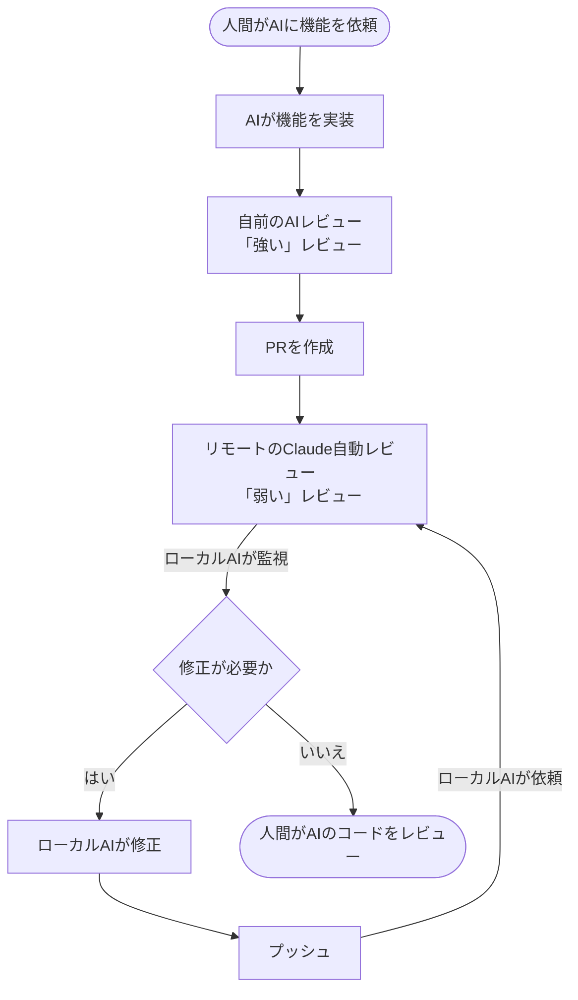

# pr-bot-review-loop

The development standard for every **firstmate-run meetsone PR**. It is personal and
experimental (captain's ruling 2026-09-09: not ready to share with the team), so it is
the required path for firstmate's own work on meetsone, not a team-facing rule.

The process, as drawn:



A human asks for a feature. The AI implements it. A **strong** local AI review runs
first (`kakkoidev/pr-review`). The PR opens. The **weak** remote Claude bot reviews it.
The local AI watches, fixes what is real, pushes, and requests the next round. Only when
a round comes back with nothing actionable does a human review the code.

The strong/weak split is the point: the local review is the one with the repo checked
out, the suite runnable, the ticket fetched and the scars loaded. The bot is a
second pair of eyes with none of that. This skill is the discipline that makes a weak
reviewer useful instead of noisy - and the loop's own output is code too, so it gets
re-checked every round (R5).

## The rules

Twelve rules, each from a real failure, live in `references/loop-rules.md` with the reason
attached. **Read that file at stage 01 and keep it open**; the stages cite them as `R<n>`
and the gates mechanically enforce R1..R7 and R9..R11.

| Rule | One line |
|------|----------|
| R1 | A request comment without an `@claude` mention never fires - verify a run started |
| R2 | No round cap; loop until a round comes back with nothing actionable |
| R3 | Findings are hypotheses - refuse a wrong finding, and refuse a wrong fix to a right finding |
| R4 | Every behavioural fix needs a test that fails on revert, proven both ways |
| R5 | The loop introduces its own regressions - re-check the PR's own defect class each round |
| R6 | Scope refusals get written down (5-step procedure), never silently dropped |
| R7 | Do not let a stale review round pass as current - record the reviewed commit |
| R8 | Read CI honestly - a green wrapper can hide a crashed step, a red gate can be a poll race |
| R9 | Any push requires a fresh round on the new head - pushing and declaring done is a defect |
| R10 | Every bot thread is answered with its outcome and resolved as it is addressed |
| R11 | Superseded bot reports and every review-request comment (including the last) are collapsed as OUTDATED - as the closing step, after convergence; only the final bot report stays visible |
| R12 | A guard refusing one route is not proof the capability is missing - check the approved wrapper before reporting a blocker |

## Determinism boundary (read this)

- **Deterministic** - a `tools/` script, no model judgment: whether the request comment
  carried an `@claude` mention and whether bot activity followed it
  (`tools/verify-request-fired`, R1); which commit each round reviewed vs the head at
  that moment (`tools/gather-round`, R7); per-job/per-step CI conclusions and the
  crash/poll-race markers (`tools/gather-ci`, R8); the two-direction test result
  (`tools/check-revert-proof`, R4); which bot reports are superseded and still expanded
  (`tools/gather-round`, R11); which review-request comments the loop posted across every
  round, collected for collapsing (`tools/gather-requests`, R11); and the completeness
  audit of the ledger (`tools/ledger-audit`, R2/R3/R6/R9/R10/R11).
- **Model judgment, recorded not automated** - whether a finding is true, whether a
  proposed fix is right, whether an item is out of scope, and whether a SUSPECT CI row is
  a real failure or infrastructure. The tools make these judgments *visible and
  accounted for*; they do not make them.
- **The exit gate does not re-fetch.** `checks/loop-exit.sh` compares the last round's
  `reviewed_sha` against `exit-head.tsv`, which `tools/gather-round --head-only` wrote.
  The check is hermetic and offline (a gate that shells out to `gh` costs an approval
  click per Write and can wedge on a network blip); the freshness comes from the tool
  that wrote the file, and the file is timestamped so a stale one is visible.

## Pipeline

| Stage | Does | Output |
|-------|------|--------|
| 01-preflight | preconditions: the strong local review ran, the PR exists, the bot's login + mention handle are known, the PR's own defect class is named (R5), the ledger is initialised | `preflight.md`, `rounds.tsv`, `ledger.tsv` |
| 02-round | the loop, repeated with no cap (R2): request with a mention and verify it fired (R1) -> harvest the round against the commit it reviewed (R7) -> triage each finding as a hypothesis (R3) -> fix with a revert-proven test (R4) -> re-check the PR's own defect class (R5) -> answer and resolve each thread (R10) -> read CI honestly (R8) -> push -> next round (R9) | `round-<n>.md`, `round-<n>.tsv`, `request-<n>.tsv`, `ci-<n>.tsv`, `revert-proof-<n>.tsv`, `threads-<n>.tsv`, `bot-comments-<n>.tsv`, appended `rounds.tsv` + `ledger.tsv`, `pr-body.md`, `exit-head.tsv` |
| 03-close | the exit gate (a quiet round, on the current head, with no open threads), then the closing cleanup: collapse every superseded bot report as OUTDATED keeping the final one visible, and collapse every review-request comment the loop posted including the last (R11), the PR-body ledger of refusals and out-of-scope items with their tickets, the honest CI line, the human handoff | `close.md`, `ledger-audit.tsv`, `superseded.tsv`, `superseded-requests.tsv` |

## Invocation

```
icm.sh init kakkoidev/pr-bot-review-loop
```
Inputs (from the chat that starts the run): `<owner>/<repo>`, the PR number, and the
ticket the PR is scoped to. Run `kakkoidev/pr-review` **first** - this skill starts
after the strong review, not instead of it.

## Runtime

This workspace uses the ICM runtime. Never scaffold dirs, copy files, or format
timestamps yourself - delegate to `icm.sh` via bash:
```
bash ~/.agents/skills/icm/runtime/icm.sh <command> kakkoidev/pr-bot-review-loop
```
After `init`, read the run path from stdout. Each stage's contract is
`<run>/<stage>/CONTEXT.md`. After each stage, `icm.sh next kakkoidev/pr-bot-review-loop`
finds the next empty stage.

**The loop lives inside stage 02.** ICM stages are linear and sealed once; the loop is
not. So 02 is not "one round" - it is the whole loop, and it is not done until the exit
condition holds. Rounds are numbered inside it (`round-<n>.*`, one `rounds.tsv` row
each). Never close 02 with `stage-done` to "check in" between rounds: a closed stage
cannot be reopened, and the audit flags duplicate closures.

## Per-stage telemetry (MANDATORY)

After writing a stage's output, immediately:
```
bash ~/.agents/skills/icm/runtime/icm.sh stage-done kakkoidev/pr-bot-review-loop --stage <stage-name>
```

## Audit + seal

```
bash ~/.agents/skills/icm/runtime/icm.sh audit kakkoidev/pr-bot-review-loop
bash ~/.agents/skills/icm/runtime/icm.sh seal kakkoidev/pr-bot-review-loop
```

## Reference

- `references/loop-rules.md` - the ten rules with their reasons and source PRs, plus the
  five-step scope-refusal procedure. Frozen into the run and read at 01.
- `tools/verify-request-fired` - R1: `@claude` mention present in the request comment AND
  bot activity after it. Two independent signals, both recorded; `run_started=no` means
  the round did not happen.
- `tools/gather-round` - R7/R10: the round's bot output, the `commit_id` it reviewed, the
  head at that moment, the staleness verdict, and every review thread with its
  resolved/replied state. `--head-only` writes `exit-head.tsv` for the close gate.
- `tools/gather-ci` - R8: per-check, per-job, per-step conclusions plus `# SUSPECT:` rows
  for a green wrapper over a failed/crashed step and for a red gate whose underlying
  analysis passed. Every SUSPECT is resolved by reading the step, never by grepping.
- `tools/check-revert-proof` - R4: runs the named test on the fix and on the reverted
  source in a throwaway worktree; `PROVEN` requires pass-then-fail. Also flags the
  `toHaveBeenCalledWith` trap in the round's added test lines.
- `tools/ledger-audit` - the mechanical half of the rules, in three modes: `audit`
  (per-round and per-finding completeness, safe mid-loop), `converged` (adds the exit
  condition - a quiet round on the current head, nothing pushed after it, no thread left
  open or unanswered) and `closed` (adds R11: every superseded bot report collapsed with
  the final one still visible, AND every review-request comment collapsed including the
  last).
- `tools/mark-superseded` - R11: collapses issue comments with
  `minimizeComment(classifier: OUTDATED)`, through `gh-axi api POST /graphql` and batched
  as GraphQL aliases so the whole cleanup is one approval (proven on PR 26204). Dry-run
  unless `--apply`; refuses any comment not authored by the given login and cannot reach a
  review or a human's pending draft. Used twice in 03-close: once against
  `bot-comments-<last>.tsv` (never collapses the latest bot report), once against
  `gather-requests`' output (collapses every request comment, latest included - the input
  TSV marks every row `superseded=yes`, so the tool itself needs no bot/request distinction).
  Run only in 03-close, after convergence - never between rounds.
- `tools/gather-requests` - R11: collects every `request_comment_id` the loop posted
  (from `request-<n>.tsv` across all rounds) with its live minimized state, so the closing
  cleanup can feed them to `tools/mark-superseded` and collapse all of them - including the
  last one, which is pure machinery ("@claude review, round N, head is X") and carries
  nothing a human or a later round needs. Captain's ruling, 2026-09-09.
- `checks/loop-exit.sh` - the close gate; blocks stage 03's Write until `ledger-audit`
  passes in exit mode.
- `eval/structure.test.sh` - skill shape and that all twelve rules survive with their
  reasons. `eval/*.test.sh` - the deterministic freezes for R1, R8 and the ledger audit.
